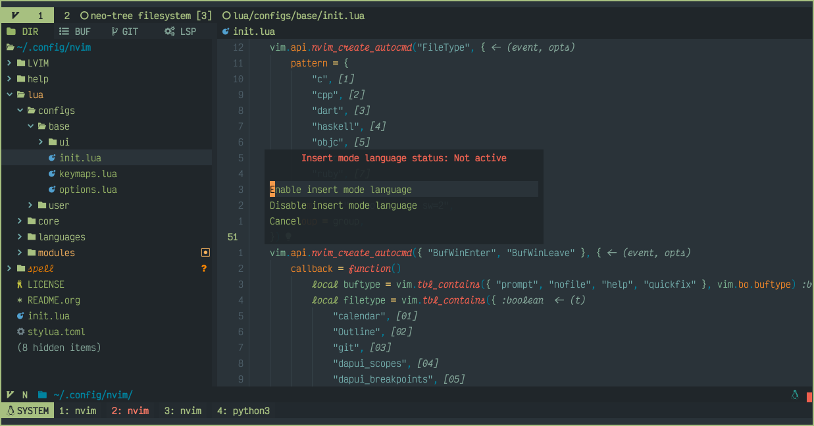
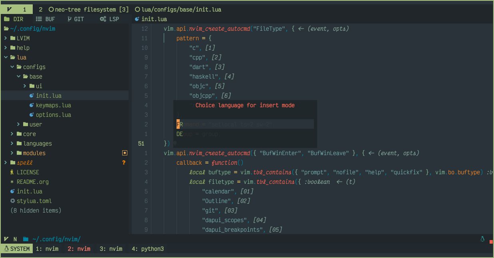
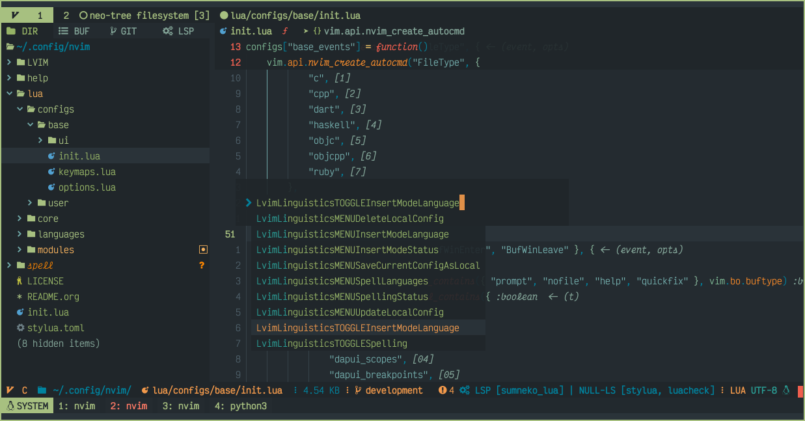
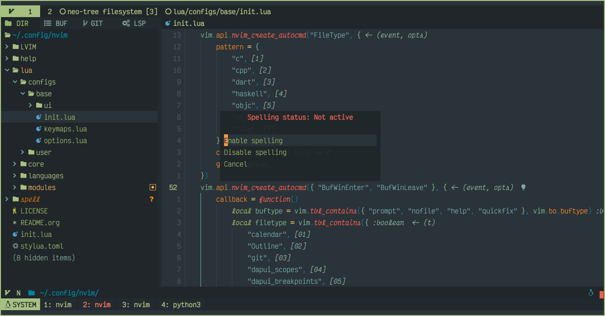
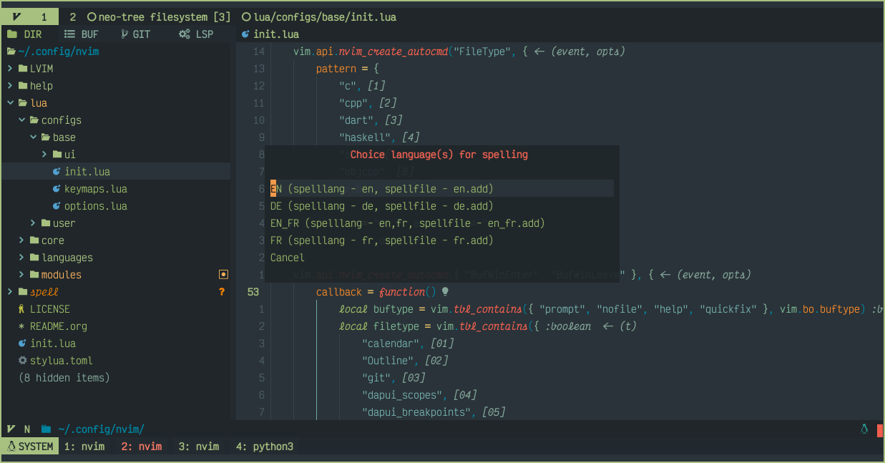
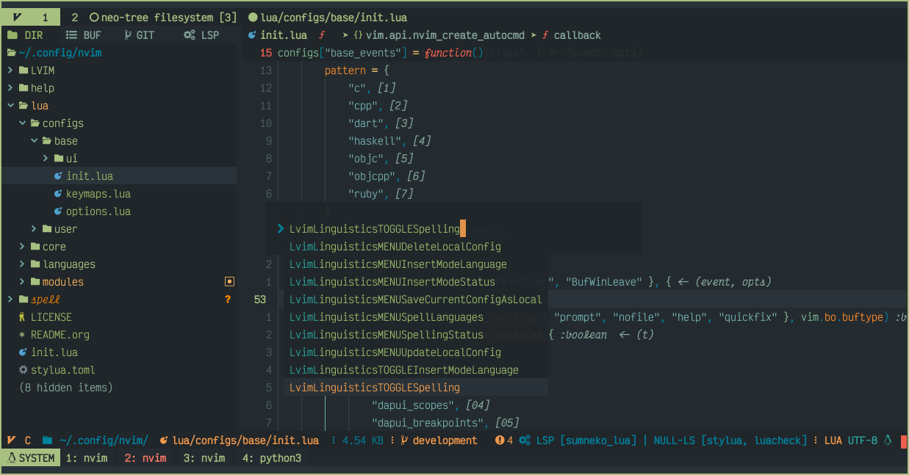
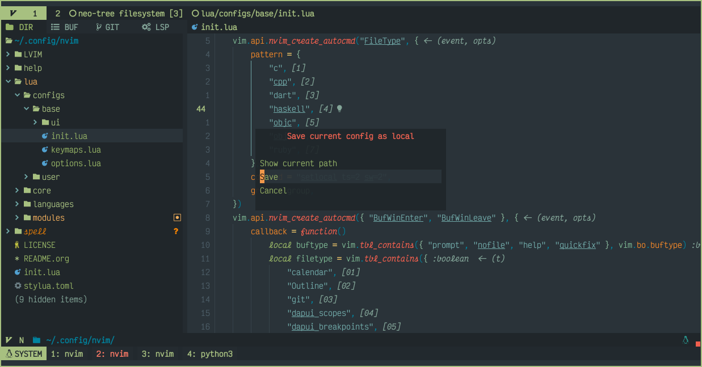
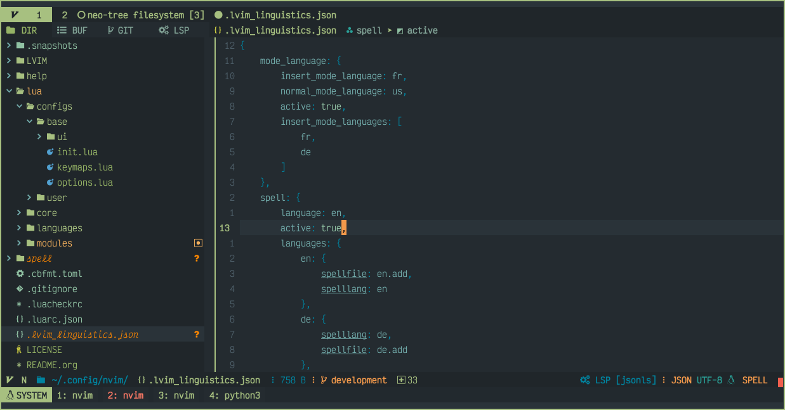
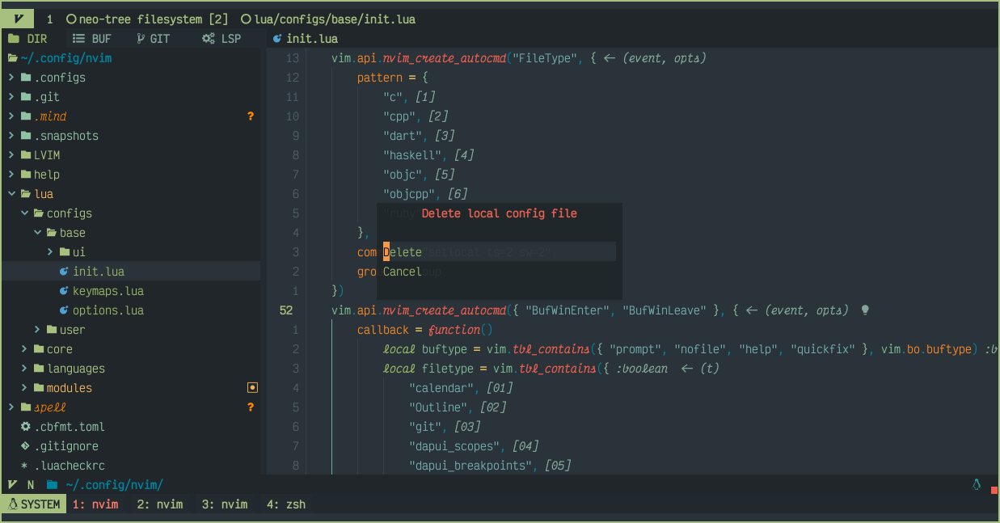

# LVIM LINGUISTICS

Lvim Linguistics controls spelling and keyboard language in insert mode — useful when
writing documents in a foreign language. Supports per-project local config
(`.lvim/linguistics/config.json` in the project root).


[](https://github.com/lvim-tech/lvim-linguistics/blob/main/LICENSE)

## Requirements

Keyboard switching depends on your display server. The plugin auto-detects the session and picks the right tool:

| Session            | Tool                                              |
| ------------------ | ------------------------------------------------- |
| X11                | [xkb-switch](https://github.com/grwlf/xkb-switch) |
| Wayland — Hyprland | `hyprctl` (bundled with Hyprland)                 |
| Wayland — niri     | `niri` (bundled)                                  |
| Wayland — sway     | `swaymsg` (bundled)                               |
| Wayland — mango    | [mmsg](https://github.com/mangowm/mango)          |
| Wayland — GNOME    | `gdbus` (bundled with GLib)                       |

> You can always override `kbrd_cmd` manually — see configuration below.

## Installation

Requires Neovim >= 0.10, [lvim-utils](https://github.com/lvim-tech/lvim-utils) and
[lvim-ui](https://github.com/lvim-tech/lvim-ui) (the settings panel).

### lvim-installer (recommended)

Install and manage it from the LVIM package manager — open the **Plugins** tab and install / update / pin it:

```vim
:LvimInstaller plugins
```

lvim-installer installs plugins through Neovim's built-in `vim.pack`, so no external plugin manager is needed.

### Native (vim.pack)

```lua
vim.pack.add({
    { src = "https://github.com/lvim-tech/lvim-utils" },
    { src = "https://github.com/lvim-tech/lvim-ui" },
    { src = "https://github.com/lvim-tech/lvim-linguistics" },
})
require("lvim-linguistics").setup({})
```

## Configuration

Every option, at its default value:

```lua
require("lvim-linguistics").setup({
    plugin_config = {
        -- Keyboard switch command. Auto-detected from XDG_SESSION_TYPE /
        -- XDG_CURRENT_DESKTOP / WAYLAND_DISPLAY at startup, so the default shown
        -- here depends on the session. Can be a string prefix or a function:
        --
        --   kbrd_cmd = function(lang)
        --       local idx = { en = 0, bg = 1 }
        --       return "hyprctl switchxkblayout all " .. (idx[lang] or 0)
        --   end
        --
        kbrd_cmd = "xkb-switch -s ",

        -- Folder where spell files (.spl) are stored. Files are downloaded
        -- automatically on first use (async, no blocking).
        spell_files_folder = os.getenv("HOME") .. "/.config/nvim/spell",
    },

    settings_panel = {
        -- The user command that opens the panel and carries the quick toggles.
        command = "LvimLinguistics",
        -- How the panel opens: "float" | "area" | "bottom".
        layout = "float",
    },

    base_config = {
        mode_language = {
            active = false,
            file_types = {
                -- Real files whose content is not prose. Panels, pickers and terminals
                -- are excluded structurally (by 'buftype'), never by name.
                black_list = { "diff", "log" },
                -- When non-empty, the feature runs ONLY in these filetypes.
                -- Either list also takes "*" — see Filetype gating.
                white_list = {},
            },
            normal_mode_language = nil, -- layout id restored on InsertLeave
            insert_mode_language = nil, -- layout id set on InsertEnter
            insert_mode_languages = {}, -- selectable layouts in the panel
        },
        spell = {
            active = false,
            file_types = {
                black_list = { "diff", "log" },
                white_list = {},
            },
            language = nil, -- active language key (must exist in languages)
            languages = {
                en = {
                    spelllang = "en",
                    spellfile = "en.add",
                },
            },
        },
    },
})
```

`base_config` is the DEFAULT profile. The settings panel's two layers are partial overlays of it
— see [The settings panel](#the-settings-panel).

### Full example

```lua
require("lvim-linguistics").setup({
    base_config = {
        mode_language = {
            active = true,
            file_types = {
                white_list = { "tex", "markdown" },
            },
            normal_mode_language = "us",
            insert_mode_language = "bg",
            insert_mode_languages = { "bg", "de", "fr" },
        },
        spell = {
            active = true,
            file_types = {
                white_list = { "tex", "markdown" },
            },
            language = "en",
            languages = {
                en = { spelllang = "en", spellfile = "en.add" },
                bg = { spelllang = "bg", spellfile = "bg.add" },
                en_bg = { spelllang = "en,bg", spellfile = "en_bg.add" },
            },
        },
    },
})
```

For Hyprland / mango (index-based layout switching), use a function for `kbrd_cmd`:

```lua
plugin_config = {
    kbrd_cmd = function(lang)
        local idx = { en = 0, bg = 1 }
        return "hyprctl switchxkblayout all " .. (idx[lang] or 0)
    end,
}
```

### Filetype gating

Each feature carries its own `file_types` block. The two lists are not applied in a fixed order —
they are compared, and the **more specific claim wins**. Either list accepts `"*"`, meaning every
filetype, which turns it into a blanket the other list can carve exceptions out of:

```lua
-- Nothing, except TeX.
file_types = { black_list = { "*" }, white_list = { "tex" } }

-- Everything, except TeX.
file_types = { white_list = { "*" }, black_list = { "tex" } }
```

So a filetype named outright in one list overrides the other list's `"*"`, in either direction.
When both claim it equally — both say `"*"`, or both name it — the black list wins.

An empty `white_list` means the same as `{ "*" }`: everything the black list has not excluded. That
is the default, so the plain `black_list = { "diff", "log" }` above behaves exactly as before.

#### Two axes: `ft` and `bt`

A list has two axes — `ft` (filetype) and `bt` (`'buftype'`) — and **both must allow** the buffer.
A bare string or a plain array is shorthand for `ft`, so these are the same list:

```lua
white_list = { "tex" }
white_list = { ft = { "tex" } }
```

Until a list names `bt`, panels, pickers, popups, terminals and prompts are excluded structurally,
by their non-empty `'buftype'` — a real file has `""`. That is what keeps the filetype lists free of
UI names they could never keep up with. Name `bt` yourself and that default gives way to the same
ranked rule:

```lua
-- Spelling in real files and in the terminal.
white_list = { bt = { "", "terminal" } }
```


## Commands

All functionality is exposed through a single command with subcommands:

```
:LvimLinguistics [subcommand]
```

| Subcommand           | Description                                                     |
| -------------------- | -------------------------------------------------------------- |
| _(none)_             | Open the settings panel                                        |
| `global`             | Open the panel on the **Global** tab                           |
| `local`              | Open the panel on the **This directory** tab                   |
| `toggle-spelling`    | Toggle spell checking on/off, for this session (no panel)      |
| `toggle-insert-mode` | Toggle insert-mode language switching on/off (no panel)        |

A trailing `float` / `area` / `bottom` picks how the panel opens, overriding
`settings_panel.layout` for that one open:

```
:LvimLinguistics local bottom
```

### The settings panel

Two tabs, the same settings on each — the tab chooses **where a permanent save lands**:

| Tab              | Stored in                                     | Reaches            |
| ---------------- | --------------------------------------------- | ------------------ |
| `Global`         | the control center's database                 | every project      |
| `This directory` | `<cwd>/.lvim/linguistics/config.json`         | this directory — and it wins |

The global half is deliberately **not** a file of the plugin's own: those are editor-wide
preferences, so they live with every other one, in the control center. The same values are editable
from its own panel — one store, two ways in. The per-directory override is the half that cannot live
there (a one-value-per-name database has no notion of a directory), so it stays a document in the
project.

To get the global rows in your control center, splice the plugin's settings into a group of your own
— see `lvim-linguistics.store`: `store.bind_global(fn)` tells the plugin where to persist them, and
`store.set_global(key, value)` / `store.save_global(key, value)` are the session and permanent
halves. Without a binding the global layer is session-only.

The model is **edit = now, save = forever**:

- Changing a row takes effect immediately and writes **nothing** — close Neovim and it is gone.
  That is exactly what the `toggle-*` subcommands do.
- **Save permanently** stores the tab's values in that tab's layer. On the local tab it reads
  **Rewrite this directory's settings** once the document exists.
- **Delete this directory's settings** removes the document, so the global settings apply here
  again. It is inert while there is none.

While this directory has no document of its own, the two tabs are the same thing: the local tab
mirrors the global one live, including edits that have not been saved yet.

#### What the document contains

The first save **creates** it as a full copy of everything that applies here — the settings from
`setup()` and the global layer both, gating lists included — so the file is a complete starting
point you can edit by hand:

```json
{
    "spell": {
        "active": true,
        "language": "bg",
        "file_types": { "black_list": ["diff", "log"], "white_list": [] }
    }
}
```

Every save **after** that only patches the four values the panel surfaces (`active`, `language`,
`insert_mode_language`). Whatever you have hand-written in the file — a `white_list`, a `bt` axis —
is yours and is left alone.

The one thing a new document does not copy is the **catalogues**, `languages` and
`insert_mode_languages`: those are what the install offers to choose from, not a choice about this
directory, so a language you add to `setup()` later still reaches every project.

### Keymaps example

```lua
vim.keymap.set(
    "n",
    "<C-c>s",
    "<cmd>LvimLinguistics toggle-spelling<cr>",
    { noremap = true, silent = true, desc = "Toggle spelling" }
)

vim.keymap.set(
    "n",
    "<C-c>l",
    "<cmd>LvimLinguistics toggle-insert-mode<cr>",
    { noremap = true, silent = true, desc = "Toggle insert mode language" }
)
```

## Screenshots

Insert-mode keyboard language:





Spelling:





Per-project local config:





## Spell files

Spell files (`.spl`) are downloaded automatically from the Vim FTP mirror the first time a language is activated. The download is **non-blocking** — Neovim stays responsive and a notification appears when the file is ready.

## Highlights

The plugin defines the following highlight groups via `lvim-utils.highlight`. They adapt automatically to palette changes (e.g. when switching colorschemes via `lvim-colorscheme`).

| Group                        | Default color  | Purpose                           |
| ---------------------------- | -------------- | --------------------------------- |
| `LvimLinguisticsIcon`        | teal           | General icons                     |
| `LvimLinguisticsSpellActive` | green          | Active spell indicator            |
| `LvimLinguisticsSpellLang`   | blue           | Language name                     |
| `LvimLinguisticsSpellSep`    | blue (blended) | Separator                         |
| `LvimLinguisticsLangActive`  | purple bold    | Active language in mode switching |
| `LvimLinguisticsLangNormal`  | teal           | Normal mode language              |
| `LvimLinguisticsLangInsert`  | yellow         | Insert mode language              |

Override in your colorscheme or config:

```lua
vim.api.nvim_set_hl(0, "LvimLinguisticsSpellActive", { fg = "#your_color" })
```

## Statusline integration

```lua
-- Heirline example
local spell = {
    condition = function()
        return require("lvim-linguistics.status").spell_has()
    end,
    provider = function()
        return require("lvim-linguistics.status").spell_get()
    end,
    hl = { fg = "#YOUR_COLOR", bold = true },
}
```
